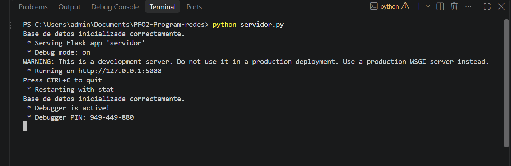
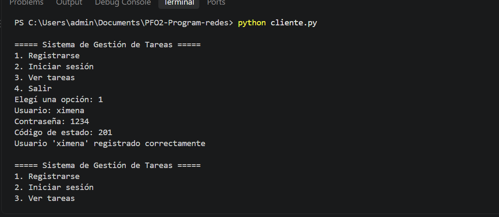
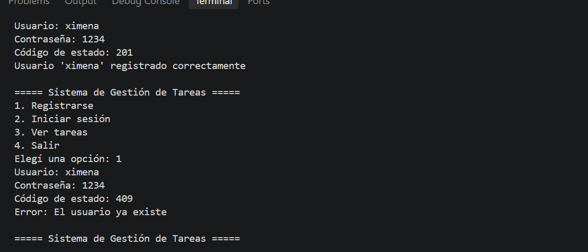
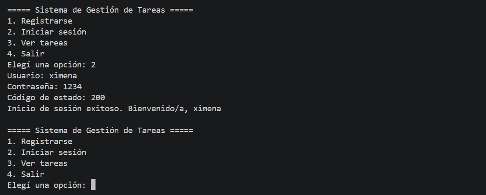
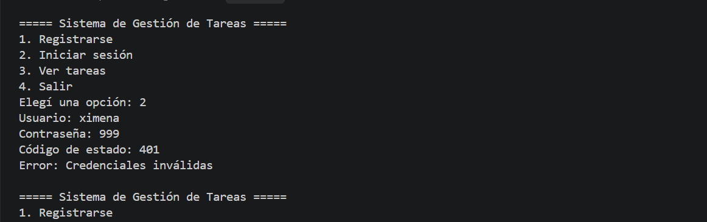
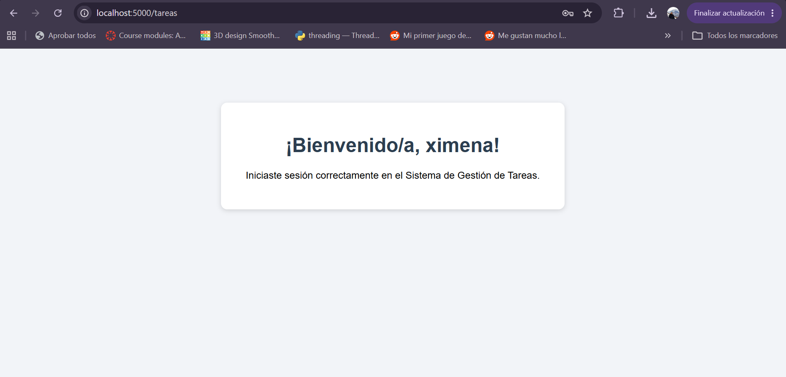
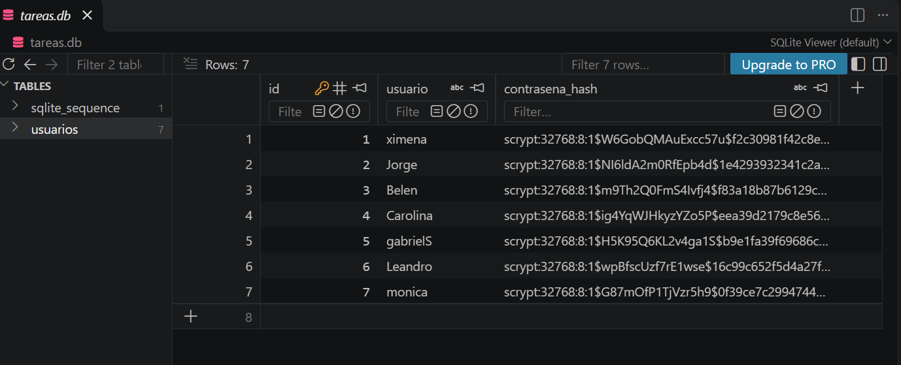

# PFO 2: Sistema de Gestión de Tareas con API y Base de Datos

## 🎯 Objetivos

* ✅ Implementar una API REST con endpoints funcionales.
* ✅ Utilizar autenticación básica con protección de contraseñas.
* ✅ Gestionar datos persistentes con SQLite.
* ✅ Construir un cliente en consola que interactúe con la API.

---

## 📁 Estructura del proyecto

```text
PFO2-Program-redes/
├── servidor.py        ← API Flask + SQLite
├── cliente.py         ← Cliente de consola que consume la API
├── requirements.txt   ← Librerías necesarias
├── README.md          ← Documentación
├── capturas/          ← Capturas de pantalla de las pruebas
└── tareas.db          ← Base de datos (se crea automáticamente)
```

---

## 🖥️ Servidor (API Flask)

| Método | Endpoint    | Descripción                                                     |
| ------ | ----------- | --------------------------------------------------------------- |
| POST   | `/registro` | Registra un usuario. Guarda la contraseña **hasheada** en SQLite |
| POST   | `/login`    | Verifica las credenciales del usuario                            |
| GET    | `/tareas`   | Muestra un HTML de bienvenida (requiere autenticación básica)    |

### Formato de los datos

`/registro` y `/login` reciben un JSON:

```json
{"usuario": "nombre", "contraseña": "1234"}
```

### Respuestas del servidor

| Código | Significado                                     |
| ------ | ----------------------------------------------- |
| 200    | Inicio de sesión o acceso correcto              |
| 201    | Usuario registrado correctamente                |
| 400    | Faltan datos (usuario o contraseña)             |
| 401    | Credenciales inválidas o acceso sin autenticar  |
| 409    | El usuario ya existe                            |
| 500    | Error al acceder a la base de datos             |

---

## 🗄️ Base de datos

Se utiliza el módulo `sqlite3`. La base `tareas.db` se crea automáticamente al iniciar el servidor.

Tabla `usuarios`:

| Campo             | Descripción                                    |
| ----------------- | ---------------------------------------------- |
| `id`              | Identificador del usuario                      |
| `usuario`         | Nombre de usuario (único)                      |
| `contrasena_hash` | Hash de la contraseña (nunca en texto plano)   |

Las contraseñas se hashean con `generate_password_hash` de la librería **Werkzeug** (incluida con Flask).
Un registro guardado se ve así:

```text
1 | xime | scrypt:32768:8:1$ndm549HXV9brSvJq$e7c977c4d6f4...
```

---

## ⚙️ Instalación

**1. Clonar el repositorio:**

```bash
git clone https://github.com/ximefacal/PFO2-Program-redes.git
cd PFO2-Program-redes
```

**2. Instalar las dependencias:**

```bash
pip install -r requirements.txt
```

---

## 🧪 Ejecución y pruebas

**1. Iniciar el servidor:**

```bash
python servidor.py
```

Debería aparecer:

```text
Base de datos inicializada correctamente.
 * Running on http://127.0.0.1:5000
```

**2. En otra terminal, iniciar el cliente:**

```bash
python cliente.py
```

```text
===== Sistema de Gestión de Tareas =====
1. Registrarse
2. Iniciar sesión
3. Ver tareas
4. Salir
Elegí una opción:
```

**3. Probar las opciones en orden:** registrarse → iniciar sesión → ver tareas.


### Prueba desde el navegador

Entrar a `http://localhost:5000/tareas`. El navegador pide usuario y contraseña; al ingresar
los de un usuario registrado se muestra el HTML de bienvenida.

---

## 📸 Capturas de pantalla

### Servidor iniciado


### Registro exitoso


### Usuario repetido (error 409)


### Inicio de sesión exitoso


### Credenciales inválidas (error 401)


### HTML de bienvenida en /tareas


### Contraseña hasheada en la base de datos


---

## 💬 Respuestas conceptuales

### ¿Por qué hashear contraseñas?

Porque la base de datos nunca debe contener las contraseñas reales de los usuarios. Si un atacante
llegara a robar la base, con contraseñas en texto plano tendría acceso inmediato a todas las cuentas
(y probablemente a otros servicios, ya que muchas personas repiten contraseñas).

El hash es una función de **un solo sentido**: a partir del hash no se puede obtener la contraseña
original. Para verificar un inicio de sesión, el servidor hashea la contraseña ingresada y la compara
con el hash guardado.

Además, la librería utilizada agrega una **sal** (*salt*) aleatoria a cada contraseña, por lo que dos
usuarios con la misma contraseña tienen hashes distintos, y utiliza un algoritmo lento a propósito
(scrypt), lo que dificulta los ataques de fuerza bruta y de tablas precalculadas.

A diferencia del cifrado (por ejemplo, AES), el hash no es reversible: si se cifraran las contraseñas
y un atacante obtuviera la clave junto con la base de datos, podría leerlas todas.

### Ventajas de usar SQLite en este proyecto

* **No requiere instalar ni configurar un servidor de base de datos:** viene incluido en Python
  (módulo `sqlite3`).
* **Toda la base es un solo archivo** (`tareas.db`), fácil de crear, copiar y entregar junto al proyecto.
* **Persistencia:** los usuarios registrados se mantienen aunque el servidor se reinicie.
* **Soporta SQL estándar**, restricciones como `UNIQUE` y **consultas parametrizadas**, que previenen
  la inyección SQL.
* **Es liviano y suficiente** para un proyecto con pocos usuarios y baja concurrencia, como este.

Su limitación es que no está pensado para muchas escrituras simultáneas ni para varios servidores
accediendo a la misma base; en ese caso convendría un motor como PostgreSQL o MySQL.

---

## 💡 Mejoras y conceptos aplicados

* 🔐 **Contraseñas hasheadas con sal** (Werkzeug / scrypt), nunca en texto plano.
* 🛡️ **Autenticación básica HTTP** para proteger el endpoint `/tareas`.
* 💉 **Consultas parametrizadas** (`?`) para evitar inyección SQL.
* 🚫 **Mensaje genérico de error en el login**, para no revelar si el usuario existe.
* 🧩 **Modularización:** funciones separadas para la base de datos, la verificación de credenciales
  y cada endpoint.
* ⚠️ **Manejo de errores:** datos faltantes, usuario repetido, credenciales inválidas, base de datos
  no accesible y servidor apagado (en el cliente).
* 💻 **Cliente de consola** con menú que consume la API mediante la librería `requests`.

---

## 🌐 GitHub Pages

GitHub Pages solo publica contenido estático (HTML, CSS, Markdown), por lo que no puede ejecutar un
servidor Flask. En Pages se aloja la **documentación del proyecto** (este README con las capturas);
el servidor se ejecuta localmente siguiendo las instrucciones de arriba.
